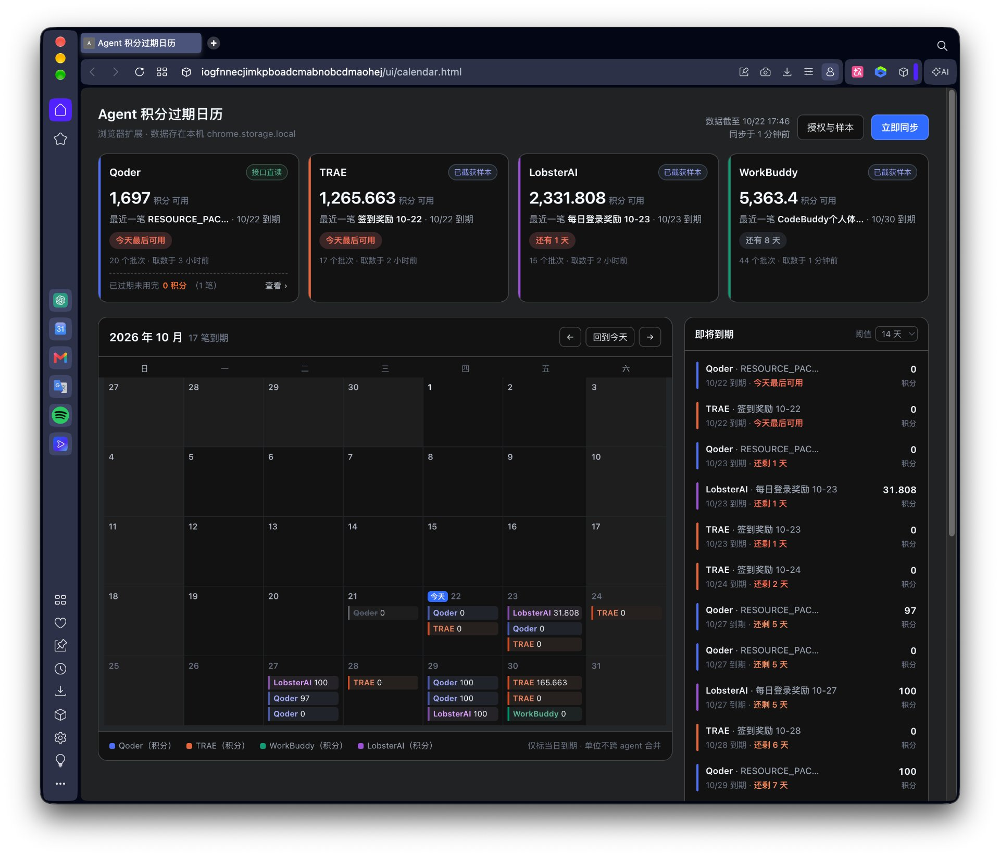

# Agent 积分过期日历

一句话：**我在四家 AI Agent 平台上还剩多少积分、分别哪天失效、该先花掉哪一笔。**

各家平台的积分不是"一笔总余额"，而是**分批发放、每批各带独立过期时间**（月度套餐包、活动赠送包、加购包到期日完全不同），
所以只记「余额 + 一个过期日」必然算错。本项目按**批次（CreditBatch）**建模，在月历上标出哪一天有什么到期，
再用「即将到期 / 余额总览」回答"该赶紧花掉哪一笔"。

支持的平台：**Qoder、TRAE、WorkBuddy、LobsterAI**。



一眼能读到的三件事：**每个平台还剩多少**（左上卡片）、**哪一天有哪几笔到期**（月历格子里的彩色条目，
按平台分色，格子里带金额）、**接下来两周先花哪几笔**（右侧「即将到期」按临期天数排序）。

## 形态

Chrome MV3 浏览器扩展，无构建步骤，浏览器直接装载 `extension/` 目录（Opera 等 Chromium 内核浏览器同样适用）。
早期「本地单页网页 + Node/Playwright 抓取」方案已废弃，决策记录见 `REQUIREMENTS.md` §7。

## 目录

| 路径 | 内容 |
| --- | --- |
| `extension/` | 扩展本体（`manifest.json`、`background.js`、`adapters/`、`lib/`、`ui/`、`test/`） |
| `extension/README.md` | 扩展的安装、使用与版本变更说明（细节都在这里） |
| `REQUIREMENTS.md` | 需求规划与决策记录（领域模型、抓取策略、历史决策） |
| `CODE_REVIEW.md`、`CODE_REVIEW_v0.3.15.md` | 代码审查记录 |
| `prototype/index.html` | 早期静态原型 |
| `docs/images/` | README 用的界面截图 |

## 跑起来

1. Chrome / Opera 打开扩展管理页，开启「开发者模式」
2. 选择「加载已解压的扩展程序」，指向 `extension/` 目录
3. 点工具栏上的扩展图标打开日历页，右上角「授权与样本」里逐家登录一次授权，
   之后一般点「立即同步」即可；某个平台数据不新，就单独点它卡片里的「刷新余额」走一次活体读取

跑测试（需要 Node）：

```bash
cd extension && npm test
```

## 边界

- **全程只读**：不充值、不扣费、不改套餐，只读取平台返回的额度数据
- **凭据不入库**：登录态只存在于浏览器，代码与文档里不写任何账号标识；导出的捕获样本默认被 `.gitignore` 排除
- 不追求四平台 100% 自动覆盖，抓不通的平台降级为手动录入，不阻塞主线
- 公开文档中的真机笔数与合计均为近似值，不写具体账户额度；**唯一例外是上面那张界面截图**——
  它是单次真机快照，数字会随时间失效
